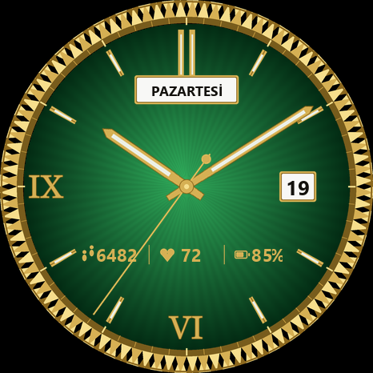
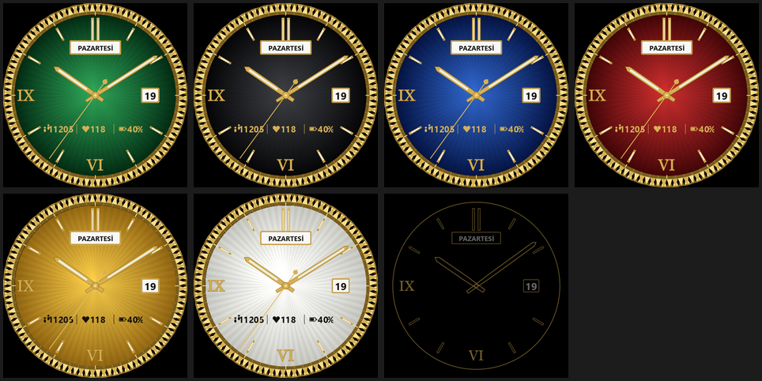

# WatchFaceGT3 — Huawei Watch GT 3 için "Gün-Tarih" stili klasik analog kadran

Güneş ışını (sunburst) kadran, yivli altın çerçeve, altın baton ibreler, 12'de gün adı penceresi, 3'te tarih penceresi, alt yarıda adım / nabız / pil. Kadran rengi altı seçenek: **siyah, sarı, mavi, yeşil, kırmızı, beyaz**. Sade bir AOD (sürekli açık ekran) varyantı vardır. Tüm katmanlar `build.py` ile üretilir; PNG'ler elle düzenlenmez. Marka logosu veya yazısı yoktur.

| Aktif (yeşil) | Renkler + AOD |
|---|---|
|  |  |

## Teknik sınırlar (GT 3, HarmonyOS 4 lite)

- Çözünürlük **466 × 466** (46 mm ve 42 mm modellerin ikisi de).
- Kadran paket sürümü **2.1.z** zorunlu ("WATCH + GT series" modu).
- Metin kontrolünde yalnız sistem fontları (Roboto) var; bu yüzden gün adları ve rakamlar **PNG** olarak üretildi.
- AOD'de siyah olmayan piksel oranı **%10 altı ideal, %20 üstü reddedilir**. Bu tasarımda en kötü durumda **≈%4,2**. `build.py` çalışınca oranı yazdırır.
- Tek görsel ≤ 750 KB (en büyük katman ≈ 210 KB, sarı arka plan).
- Dokunma kısayolları yalnız saatin yerleşik uygulamalarını açabilir.

## Üretim

Gereksinim: Python 3 + Pillow + NumPy (`pip install pillow numpy`). Fontlar Windows'tan okunur (Georgia, Segoe UI).

```bash
python build.py
```

Çıktı:

```
katmanlar/aktif/
  00_arka_plan_{siyah,sari,mavi,yesil,kirmizi,beyaz}.png   kadran + çerçeve + indeksler + pencereler
  ibre_saat.png  ibre_dakika.png  ibre_saniye.png  merkez_kapak.png   (466x466, pivot 233,233, saat 12)
  simge_{adim,kalp,pil}_altin.png   koyu kadranlar için (24x24)
  simge_{adim,kalp,pil}_koyu.png    sarı/beyaz kadran için
  rakam_veri_altin/  rakam_veri_koyu/   0-9 + yuzde + iki_nokta  (13x28)
  rakam_tarih/       0-9 siyah (15x32) — tarih penceresi
  gun/               gun_00_Paz … gun_06_Cmt (124x30, 0 = Pazar)
katmanlar/aod/
  00_arka_plan.png  ibre_saat.png  ibre_dakika.png  merkez_kapak.png  rakam_tarih/  gun/
onizleme/
  aktif_yesil_10_09.png  aod_10_09.png  renkler_ve_aod.png
```

Renkler `KADRAN` sözlüğünde (merkez, kenar) olarak; konumlar `POS_GUN`, `POS_TARIH`, `VERI_X/VERI_Y` sabitlerinde. Değiştir → tekrar çalıştır.

## Theme Studio'da birleştirme (.hwt üretimi)

Resmi araç: **Huawei Theme Studio 11.x** (Windows/macOS), <https://developer.huawei.com/consumer/en/doc/development/Tools-Guides/theme-studio-0000001075536553>. Eski "Watch Face Designer" adı artık kullanılmıyor.

Koordinatlar aşağıda **merkez** olarak verilir; Theme Studio sol-üst köşe ister, merkezden genişlik/2 ve yükseklik/2 çıkar.

1. **New Project → Watch Face**. Device: *WATCH + GT series*, Resolution **466 × 466**, Version **2.1.z**. Proje adı: WatchFaceGT3.
2. **Arka plan (renk seçimi)**: `Background` kontrolüne `00_arka_plan_yesil.png` yükle. Kullanıcının saatte rengi değiştirebilmesi için Theme Studio'nun **Style (stil değiştirme)** özelliğini kullan: arka plan kontrolünde *Style* ekle, her stile bir renk dosyasını ata (6 stil). Saatte kadrana uzun basınca *Stil* seçeneğinden renk değişir. Not: sarı ve beyaz stillerde veri simgeleri/rakamları için `_koyu` setini, diğerlerinde `_altin` setini aynı stil gruplarına bağla (simgeler ve veri sayıları da *Style*'a dahil edilir).
3. **Gün adı**: `Image Sequence` kontrolü, veri *Week day*, `gun/` klasöründeki 7 dosya, merkez **(233,112)** → sol-üst (171,97). Dosya sırası **0 = Pazar … 6 = Cumartesi**; Theme Studio haftayı Pazartesi'den başlatıyorsa sırayı sürükleyerek düzelt, önizlemede bugünün adıyla doğrula.
4. **Tarih**: `Image Number` kontrolü, `rakam_tarih/0-9`, veri *Day*, iki hane, hizalama *center*, merkez **(372,233)**.
5. **Veri satırı** (y = 318): `Image` + `Image Number` (`rakam_veri_altin/`, hizalama center):
   - Adım: simge `simge_adim_*.png` merkez (110,318); sayı veri *Steps*, merkez (146,318). 5 haneye kadar sığar.
   - Nabız: simge `simge_kalp_*.png` (209,318); sayı veri *Heart rate*, merkez (239,318).
   - Pil: simge `simge_pil_*.png` (302,318); sayı veri *Battery*, merkez (334,318), son ek `yuzde.png`.
6. **İbreler**: `Pointer` kontrolleri. Üç ibre PNG'si tam tuval (466 × 466), **saat 12'yi gösterir**, dönme merkezi **(233,233)**. `ibre_saat.png` (Hour), `ibre_dakika.png` (Minute), `ibre_saniye.png` (Second). En üste `merkez_kapak.png` `Image` olarak (0,0).
7. **AOD**: Sol panelde *AOD* sekmesine geç; `katmanlar/aod/` dosyalarıyla arka plan, gün, tarih, saat ve dakika ibresi, merkez kapağı ekle (saniye ibresi ve veri satırı **yok**). Theme Studio'nun "AOD pixel ratio" uyarısı çıkmamalı (ölçüm ≈%4).
8. **Kapak görseli**: `onizleme/aktif_yesil_10_09.png`.
9. **Build → Export** ile `.hwt` dosyasını üret.

### Saate önizleme göndermek

1. Telefonda **Huawei Health** açık, saat bağlı olsun.
2. Theme Studio'da **Preview on device**: telefon ve bilgisayar aynı Wi-Fi ağında olmalı; Theme Studio'nun gösterdiği QR kodu Huawei Health ile tarat. Kadran geçici olarak saate yüklenir.
3. Resmi olmayan yükleme yolları (modlu Health APK, Gadgetbridge) lisans ve güvenlik riski taşır; bu projede kullanılmadı.

### Huawei Temalar'a yayınlama

1. Huawei ID ile <https://developer.huawei.com> → **Theme** hizmetine kayıt; kimlik doğrulaması (*Qualification application*) gerekir.
2. **Merchant Service** kaydı ve *Publisher Agreement* onayı (ücretli kadran için).
3. Theme Studio'da **Publish** → ad (Türkçe + İngilizce), açıklama, kapak görseli, fiyat (ücretsiz veya kademe; 3+ veri türü için en az Tier 4 isteniyor).
4. Durum *Pending Review* olur; inceleme süresi resmi olarak açıklanmıyor.
5. Onaylanınca Huawei Health → Kadranlar → Daha fazla'da görünür.

## Dosya yapısı

```
build.py        tüm katmanları ve önizlemeleri üreten script
katmanlar/      üretilen PNG katmanları (aktif + aod)
onizleme/       birleştirilmiş örnek görüntüler
README.md       bu dosya
```
