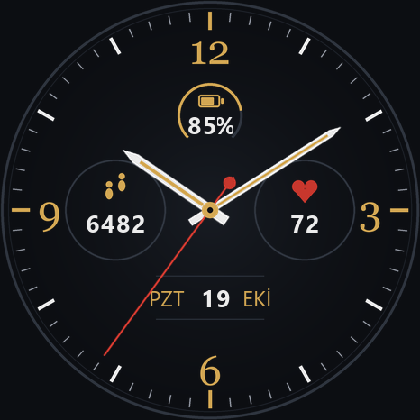
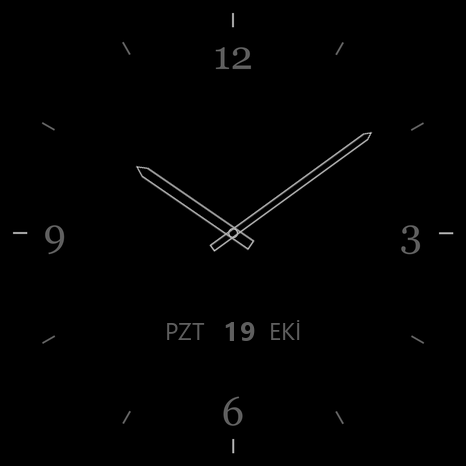

# WatchFaceGT3 — Huawei Watch GT 3 için klasik analog kadran

Koyu zeminli, altın vurgulu klasik analog kadran. Adım, nabız, pil ve tarih (gün adı + gün + ay) gösterir; sade bir AOD (sürekli açık ekran) varyantı vardır. Tüm katmanlar `build.py` ile üretilir; PNG'ler elle düzenlenmez.

| Aktif | AOD |
|---|---|
|  |  |

## Teknik sınırlar (GT 3, HarmonyOS 4 lite)

- Çözünürlük **466 × 466** (46 mm ve 42 mm modellerin ikisi de).
- Kadran paket sürümü **2.1.z** zorunlu ("WATCH + GT series" modu).
- Metin kontrolünde yalnız sistem fontları (Roboto) var; bu yüzden gün/ay adları ve rakamlar **PNG** olarak üretildi.
- AOD'de siyah olmayan piksel oranı **%10 altı ideal, %20 üstü reddedilir**. Bu tasarımda en kötü durumda **≈%2**. `build.py` çalışınca oranı yazdırır.
- Tek görsel ≤ 750 KB (en büyük katman ≈ 72 KB).
- Dokunma kısayolları yalnız saatin yerleşik uygulamalarını açabilir.

## Üretim

Gereksinim: Python 3 + Pillow (`pip install pillow`). Fontlar Windows'tan okunur (Georgia, Segoe UI).

```bash
python build.py
```

Çıktı:

```
katmanlar/aktif/   00_arka_plan.png, ibre_saat/dakika/saniye.png, merkez_kapak.png,
                   simge_adim/kalp/pil.png, rakam/0-9 + yuzde + iki_nokta,
                   gun/gun_00_Paz … gun_06_Cmt, ay/ay_00_Oca … ay_11_Ara,
                   pil/pil_yay_000 … pil_yay_100 (11 kare)
katmanlar/aod/     00_arka_plan.png, ibre_saat/dakika.png, merkez_kapak.png, rakam/, gun/, ay/
onizleme/          aktif_10_09.png, aktif_16_42.png, aod_10_09.png, yan_yana.png
```

Renk, konum, ibre uzunluğu gibi her şey `build.py` başındaki sabitlerde. Değiştir → tekrar çalıştır.

## Theme Studio'da birleştirme (.hwt üretimi)

Resmi araç: **Huawei Theme Studio 11.x** (Windows/macOS), <https://developer.huawei.com/consumer/en/doc/development/Tools-Guides/theme-studio-0000001075536553> adresinden indirilir. Eski "Watch Face Designer" adı artık kullanılmıyor.

1. **New Project → Watch Face**. Device: *WATCH + GT series*, Resolution **466 × 466**, Version **2.1.z**. Proje adı: WatchFaceGT3.
2. **Arka plan**: `Background` kontrolüne `katmanlar/aktif/00_arka_plan.png` yükle.
3. **Pil yayı**: `Progress / Image Sequence` tipinde bir kontrol ekle, veri kaynağı *Battery*, 11 kareyi sırayla (`pil_yay_000` → `pil_yay_100`) ver. Tam tuval boyutunda oldukları için konum 0,0.
4. **Simgeler**: `Image` kontrolü ile `simge_pil.png` (233,112 merkez), `simge_adim.png` (128,211), `simge_kalp.png` (338,211). Dosyalar 40 × 40, sol-üst köşe = merkez − 20.
5. **Sayılar**: `Image Number` (resimli sayı) kontrolü, `rakam/0.png … 9.png` seti, hizalama *center*:
   - Pil: veri *Battery*, merkez (233,138); yüzde işareti için `yuzde.png` son ek olarak eklenir.
   - Adım: veri *Steps*, merkez (128,247). 5 haneye kadar sığar.
   - Nabız: veri *Heart rate*, merkez (338,247).
   - Gün: veri *Day*, iki hane, merkez (239,330).
6. **Gün adı**: `Image Sequence` kontrolü, veri *Week day*, `gun/` klasöründeki 7 dosya. Dosya adlarındaki sıra **0 = Pazar … 6 = Cumartesi**. Theme Studio'da haftanın ilk günü farklıysa (Pazartesi = 0) sıralamayı sürükleyerek düzelt; önizlemede bugünün adıyla doğrula.
7. **Ay adı**: `Image Sequence`, veri *Month*, `ay/` klasöründeki 12 dosya (00 = Ocak). Merkez (285,330).
8. **İbreler**: `Pointer` kontrolleri. Üç ibre PNG'si de tam tuval (466 × 466) ve **saat 12'yi gösterir**, dönme merkezi **(233,233)**. Sırasıyla `ibre_saat.png` (Hour), `ibre_dakika.png` (Minute), `ibre_saniye.png` (Second). En üste `merkez_kapak.png` `Image` olarak.
9. **AOD**: Sol panelde *AOD* sekmesine geç; aynı adımları `katmanlar/aod/` dosyalarıyla tekrarla (saniye ibresi, simgeler, pil ve adım/nabız **yok**). Theme Studio'nun kendi "AOD pixel ratio" uyarısı çıkmamalı (ölçüm ≈%2).
10. **Önizleme/kapak**: `onizleme/aktif_10_09.png` dosyasını proje kapak görseli olarak seç.
11. **Build → Export** ile `.hwt` dosyasını üret.

### Saate önizleme göndermek

1. Telefonda **Huawei Health → Cihazlar → Kadranlar** açık olsun; saat bağlı olsun.
2. Theme Studio'da **Preview on device**: telefon ile bilgisayar aynı ağda olmalı, Health uygulamasının Theme Studio eşleştirme QR kodunu okut (Health → Ben → Ayarlar → Geliştirici seçenekleri gerekmez; QR Theme Studio ekranında çıkar).
3. Alternatif: `.hwt` dosyasını telefona kopyala; Huawei Health içindeki *Kadranlar → Daha fazla → Yerel kadran* yolu yalnızca Huawei Temalar'dan indirilenleri gösterir. Resmi olmayan yükleme yolları (modlu Health APK, Gadgetbridge) lisans ve güvenlik riski taşır; bu projede kullanılmadı.

### Huawei Temalar'a yayınlama

1. Huawei ID ile <https://developer.huawei.com> → **Theme** hizmetine kayıt; kimlik doğrulaması (*Qualification application*) gerekir.
2. **Merchant Service** kaydı ve *Publisher Agreement* onayı (ücretli kadran için).
3. Theme Studio'da **Publish** → ad (Türkçe + İngilizce), açıklama, kapak görseli, fiyat (ücretsiz veya kademe; 3+ veri türü için en az Tier 4 isteniyor).
4. Durum *Pending Review* olur; inceleme süresi resmi olarak açıklanmıyor (deneyimler birkaç gün ile birkaç hafta).
5. Onaylanınca Huawei Health → Kadranlar → Daha fazla'da görünür.

## Dosya yapısı

```
build.py        tüm katmanları ve önizlemeleri üreten script
katmanlar/      üretilen PNG katmanları (aktif + aod)
onizleme/       birleştirilmiş örnek görüntüler
README.md       bu dosya
```
